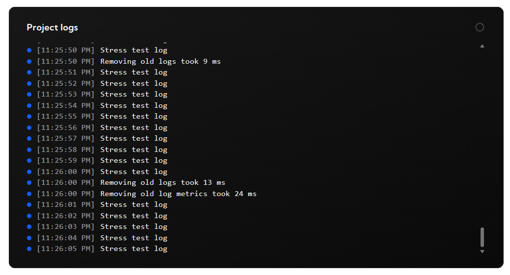

# logdash - Python SDK

Logdash is a zero-config observability platform. This package serves as a Python interface to use it.

## Pre-requisites

Setup your free project in less than 2 minutes at [logdash.io](https://logdash.io/)

## Installation

```bash
pip install logdash
```

## Logging

```python
from logdash import create_logdash

# Initialize with your API key
logdash = create_logdash({
    # optional, but recommended to see your logs in the dashboard
    "api_key": "<your-api-key>",
})

# Access the logger
logger = logdash.logger

logger.info("Application started successfully")
logger.error("An unexpected error occurred")
logger.warn("Low disk space warning")
```

## Metrics

```python
from logdash import create_logdash

# Initialize with your API key
logdash = create_logdash({
    # optional, but recommended as metrics are only hosted remotely
    "api_key": "<your-api-key>",
})

# Access metrics
metrics = logdash.metrics

# to set absolute value
metrics.set("users", 0)

# to modify existing metric
metrics.mutate("users", 1)
```

## Events

```python
from logdash import create_logdash

logdash = create_logdash({
    "api_key": "<your-api-key>",
})

logdash.track(
    "agent_run",
    props={"model": "opus", "tools": 3},
    # the signed-in user's internal ID, never an email address
    user_id="42",
)
```

Events show up in your domain's Analytics as goals, with a daily trend.
Pass `user_id` for signed-in users, so one person counts once across your website and apps.
Without it, Logdash counts a visitor of that app that changes every day.
Never put personal data in `props`.

## Flush

Logs, metrics and events are sent in the background, and a script waits for them before it exits.
Call `logdash.flush()` to wait for them sooner, for example before a serverless function returns.

## Apps

A domain key is shared by all apps of a domain, for example a desktop app, an API and a landing page.
Set `app` to name this one, so the dashboard can filter logs and metrics by app.

```python
from logdash import create_logdash

logdash = create_logdash({
    "api_key": "<your-domain-key>",
    # optional, sent with every log, metric and event
    "app": "api",
})
```

The app is created the first time it sends data.
Older service keys ignore `app`.

## View

To see the logs or metrics, go to your project dashboard




## License

This project is licensed under the MIT License.

## Contributing

Contributions are welcome! Feel free to open issues or submit pull requests.

To run the tests:

```bash
pip install -e .
python -m unittest discover -s tests
```

## Support

If you encounter any issues, please open an issue on GitHub or let us know at [contact@logdash.io](mailto:contact@logdash.io).
